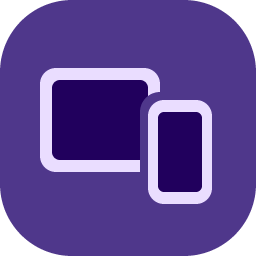
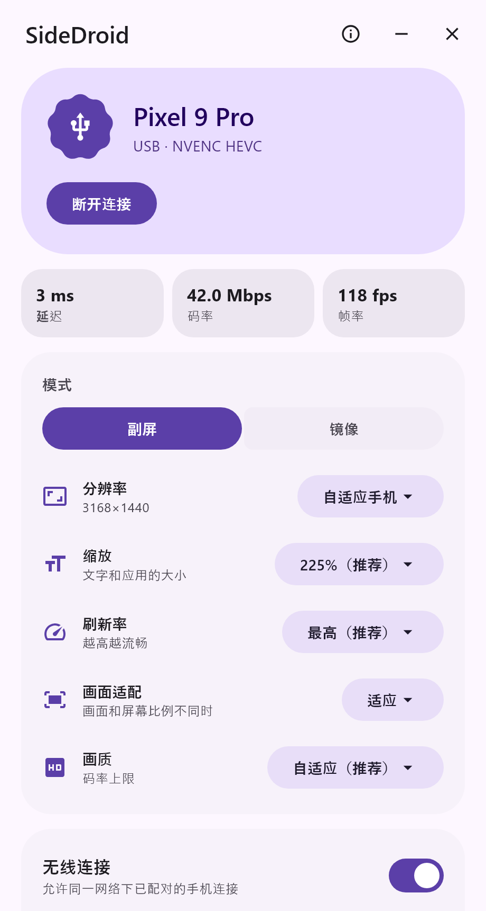
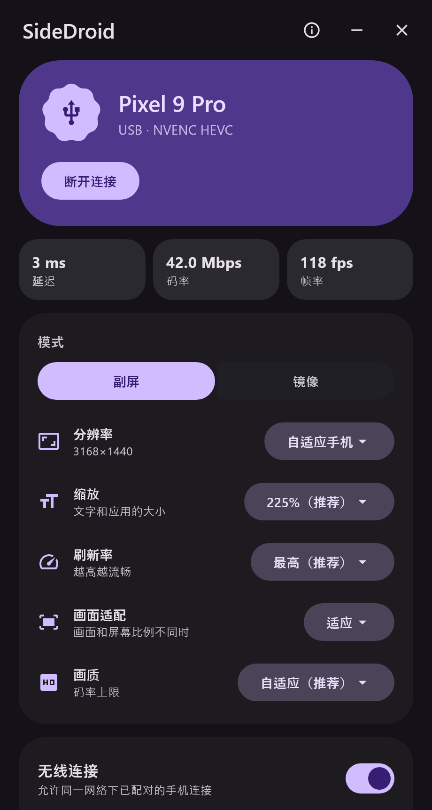
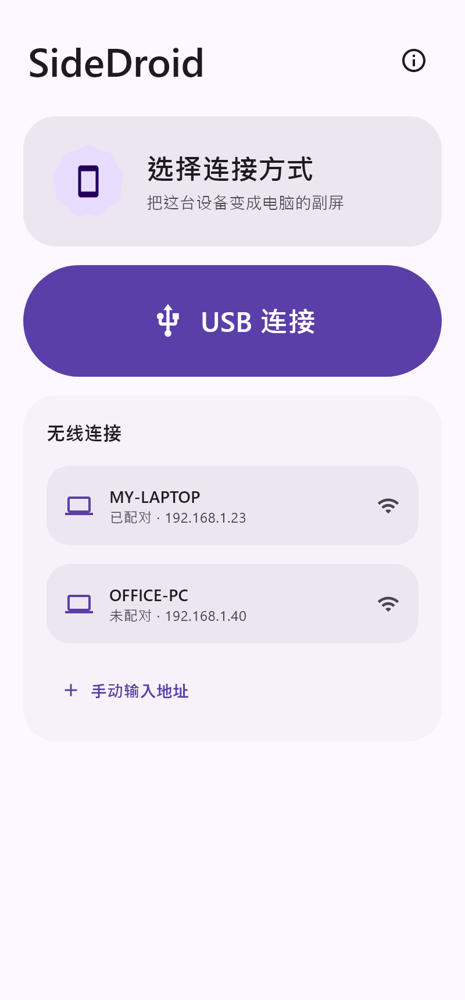
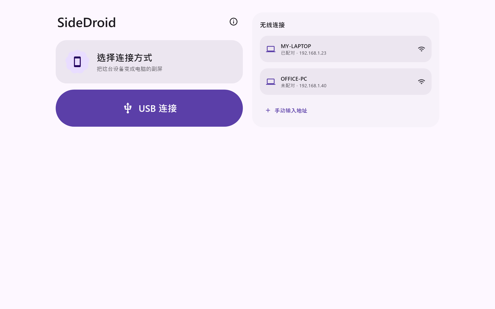
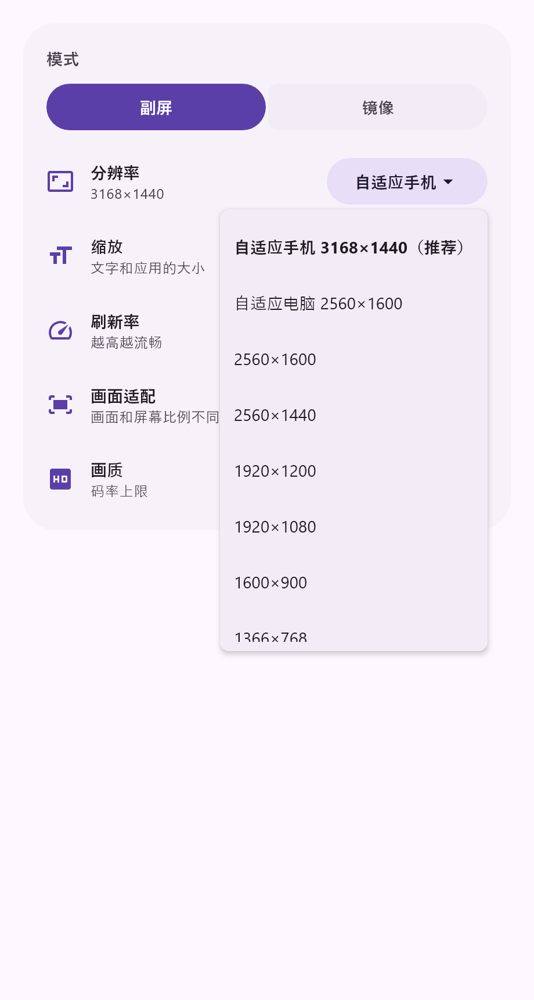
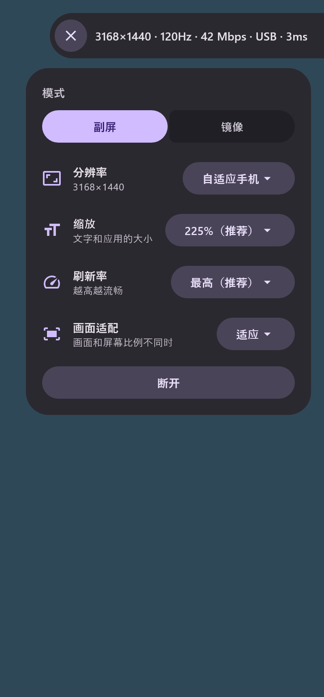

<div align="center">



# SideDroid

**一个开源的、简单的 SuperDisplay 替代品**

把 Android 手机或平板变成 Windows 的第二块屏幕。

[下载](https://github.com/Ryorin1337/SideDroid/releases/latest) · [MIT 许可证](LICENSE)

 &nbsp; 

</div>

## 功能

- **真正的副屏：** 手机是一块独立的扩展显示器，也可以随时切换成镜像。虚拟屏只在连接时存在，断开后消失，电脑的分辨率和显示布局自动恢复。
- **多台设备：** 最多同时连接 4 台，每台各是一块屏，分辨率、缩放、刷新率、画质、画面适配和编码器分开设置，控制台和托盘菜单都可以选择要调整的设备。
- **显卡和编码器：** 可以选择虚拟屏跑在哪张显卡上，以及用哪个编码器：NVENC、AMD AMF、Intel Quick Sync、Media Foundation，没有可用显卡时用 CPU 软件编码。详见 [docs/encoders.md](docs/encoders.md)。
- **USB 和 Wi-Fi：** USB 插上就能用；Wi-Fi 自动发现电脑，配对一次后不用再输配对码，传输全程加密。
- **分辨率和缩放：** 可以跟随手机、跟随电脑或选常用分辨率，缩放默认选好推荐值。
- **画面适配：** 画面和屏幕比例不同时，可以选适应、填充、拉伸或平铺，在手机、控制台和托盘里都能改。
- **刷新率：** 跟随手机屏幕，最高可到它支持的刷新率。
- **多点触控：** 在手机上直接操作 Windows。
- **自适应码率：** 网络变差时先降码率，再降帧率和清晰度，恢复后自动回升。
- **视频编码：** 自动选择可用的编码器，优先用硬件编码，支持 HEVC 和 H.264，某个编码器工作不正常时自动换下一个。
- **串流时的设置：** 把手吸附在屏幕左右两侧，平时半透明，点开后可以调整设置或断开。
- **自动检查更新：** 有新版本时提示，确认后下载、校验并调用系统安装程序。
- **Material 3 Expressive：** 电脑和手机用同一套设计，支持深色模式，手机界面适配平板和折叠屏。

## 截图

<table>
  <tr>
    <td align="center"><br>手机</td>
    <td align="center"><br>平板</td>
  </tr>
  <tr>
    <td align="center"><br>分辨率列表</td>
    <td align="center"><br>串流时的设置</td>
  </tr>
</table>

截图由应用界面渲染，其中的设备和数据是示例。

## 安装

**需要：**
- Windows 10 或更高版本（x64）。建议有支持硬件视频编码的显卡，没有时用 CPU 软件编码，帧率和画质会明显下降
- Android 8 或更高版本。Android 11 起有官方低延迟解码接口，更老的设备延迟可能更高

**步骤：**
1. 从 [Releases](https://github.com/Ryorin1337/SideDroid/releases/latest) 下载电脑端和手机端的安装包，见下表。
2. 在电脑上运行 MSI，打开控制台后点“安装驱动”，并确认 Windows 的提示。
3. 在手机上安装 APK。

| 设备 | 文件 | 说明 |
|---|---|---|
| 电脑（64 位 Windows） | `SideDroid-*-x64.msi` | 安装包 |
| 大多数手机和平板 | `SideDroid-*-android-arm64-v8a.apk` | 64 位 ARM（ARMv8） |
| 较老的手机 | `SideDroid-*-android-armeabi-v7a.apk` | 32 位 ARM（ARMv7） |
| 模拟器、部分 Chromebook | `SideDroid-*-android-x86_64.apk` | x86_64 |
| 不确定选哪个 | `SideDroid-*-android-universal.apk` | 包含以上所有类型，体积最大 |

MSI 目前没有代码签名，Windows 可能会提示风险。APK 不是从应用商店安装的，Android 也可能提示。

MSI 会安装系统服务 `SideDroidService`，它只负责在连接和断开时启用、禁用虚拟显示驱动，卸载时会一起移除。没有这个服务，虚拟屏无法使用。第一次打开控制台时，它还会询问要不要开机启动。

## 连接

**USB：** 打开手机的 USB 调试并连上电脑，在手机应用里点“USB 连接”。

**Wi-Fi：** 手机和电脑连同一网络，在控制台点“添加设备”，然后在手机上选择这台电脑并输入配对码。

托盘图标右键菜单里也能查看状态和修改设置。

## 当前状态

这是早期版本（0.1.0）。主要在一台 NVIDIA 显卡的笔记本上开发和测试，AMD AMF 只在一位用户的 Radeon Vega 8 上跑通过。以下情况还没有充分验证：

- AMD 显卡上的丢包、限速和 H.264，以及其他型号的 AMD 显卡
- 真实 Wi-Fi 环境下的长时间使用，以及多台设备共用 Wi-Fi
- Android 8 到 10 的设备，以及平板真机

遇到问题欢迎提 [Issue](https://github.com/Ryorin1337/SideDroid/issues)，并附上 `%LOCALAPPDATA%\SideDroid\host.log` 和 `adb logcat -s SideDroid` 的输出。

**已知限制：**
- 触控无法操作管理员权限的窗口和 UAC 界面。
- 镜像模式只能显示主屏。
- 改成驱动还没有的分辨率时要重启驱动，所有已连接设备的画面都会中断几秒。
- 有一台 AMD 显卡、可能是 Windows 10 的电脑，第一次连接时等了十几到几十秒屏幕才出现，原因还在确认。
- 禁用驱动时偶尔会崩溃一次，Windows 会自动恢复，下次连接正常。
- 界面目前只有中文。

## 从源码构建

需要 Visual Studio 2026（C++ 和 Windows SDK）、JDK 17，以及一个装有 Android SDK 和 NDK 的 WSL 发行版（默认路径 `/root/android-sdk`）。

```powershell
.\scripts\package.ps1   # 产物输出到 out\
```

构建 APK 还需要你自己的签名密钥。在 `android/keystore.properties`（已被 git 忽略）里写好 `storeFile`（WSL 路径）、`storePassword`、`keyAlias` 和 `keyPassword`。

| 目录 | 内容 |
|---|---|
| `core/` | C++ 协议核心，两端共用：加密、FEC、码率控制 |
| `host/` | Windows 后台程序：采集、编码、触控、显示布局 |
| `ui/design/` | 两端共用的 Material 3 Expressive 界面 |
| `ui/console/` | Windows 控制台（Compose Desktop） |
| `android/` | Android 应用和 NDK 媒体层 |
| `installer/` | MSI 安装包定义 |

协议细节见 [docs/protocol.md](docs/protocol.md)。

## 发布新版本

1. 改版本号：`CMakeLists.txt`、`android/app/build.gradle.kts`（`versionCode` 也要加一）、`ui/console/build.gradle.kts`、`ui/design/.../About.kt`、`package.ps1` 的默认值和本文的“当前状态”。
2. 运行 `.\scripts\package.ps1 -Notes "更新说明"`。
3. 提交、打标签 `v<版本号>`，把 `out\` 里的 MSI、APK 和 `SHA256SUMS.txt` 发布到 Release。
4. **Release 公开后**，把 `out\update.json` 复制到仓库根目录，提交并推送。用户的客户端读到它就会提示更新，所以顺序不能反，否则用户会下载失败。

电脑端每 12 小时、手机端每次启动时读取一次 `update.json`。其中只有版本号、说明和各文件的 SHA-256，下载地址固定为这个仓库的 Release。

## 致谢和许可

虚拟显示器由 [Virtual Display Driver](https://github.com/VirtualDrivers/Virtual-Display-Driver) 提供，加密使用 [Monocypher](https://monocypher.org/)。其他第三方组件见 [docs/THIRD_PARTY.md](docs/THIRD_PARTY.md)。

SideDroid 使用 [MIT 许可证](LICENSE)，© 2026 Ryorin。与 SuperDisplay 没有任何关联。
